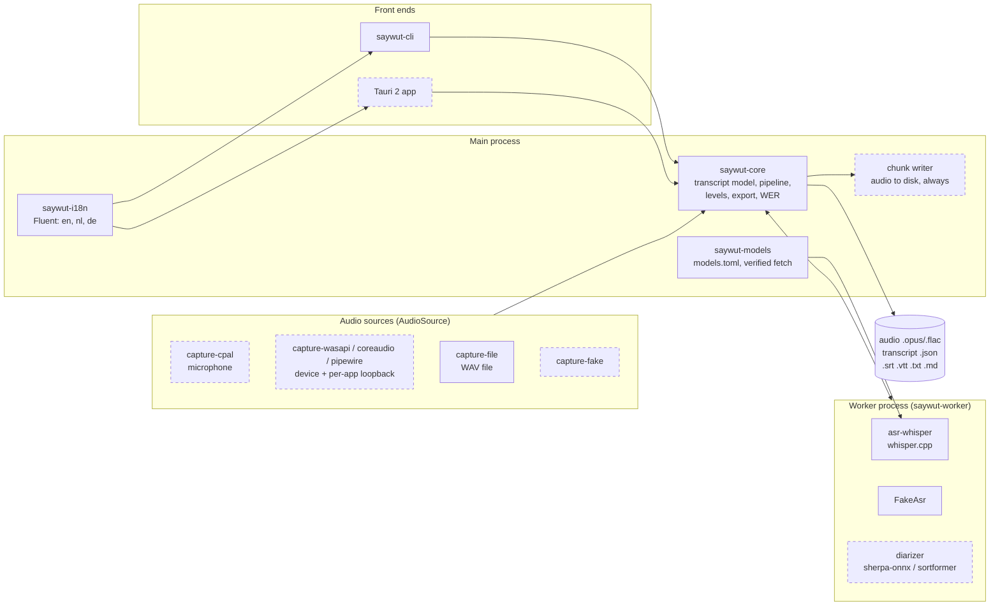

# Saywut

[](https://github.com/Langmans/saywut/actions/workflows/ci.yml)
[](LICENSE)
[](Cargo.toml)
[](.github/workflows/ci.yml)


Desktop app for live transcription with speaker diarization. It records from a
microphone, an output device or a single application, shows the transcript as
it is spoken next to a dB meter per source, and writes two files: the audio and
the transcript. An existing audio file can be transcribed as well.

Languages: speech in Dutch, English and German; UI in the same three.

Status: early. See [PLAN.md](PLAN.md) for the design and phases.

## Architecture

Ports and adapters: `saywut-core` holds the traits and all pure logic; every
adapter is a thin crate behind one of those traits. Engines are to run in a
worker process so a native crash cannot take the recording down; for now the
CLI still runs them in-process. Dashed parts are planned.



## Using the CLI

The desktop app is not there yet; the `saywut` command line is.

```sh
# Download and verify the models (sizes in `saywut models list`).
saywut models fetch whisper-base
saywut models fetch pyannote-segmentation-3
saywut models fetch campplus-voxceleb

# Transcribe a 16 kHz WAV with speaker labels; json, srt, vtt or txt.
saywut transcribe meeting.wav -l nl --diarize -f json -o meeting.json

# Name the speakers: names heard ("ik ben Anna") are suggested.
saywut speakers list meeting.json
saywut speakers suggest meeting.json
saywut speakers rename meeting.json 2 "Anna"
saywut speakers merge meeting.json 3 2      # one person split in two

# Optional: remember a voice and name it automatically next time.
saywut profiles add "Anna" meeting.wav meeting.json 2
saywut transcribe next.wav -l nl --diarize --recognize -f txt
saywut profiles delete "Anna"
```

Voice profiles store a voice embedding (a vector computed from speech), not
audio, in `voice-profiles.json` in your local data folder. They are still
biometric data: created only by `profiles add`, never uploaded, and deleted
per name.

## System requirements

Targets, not yet measured; the spike (phase 1) will confirm or adjust them.

| | Windows | macOS | Linux |
|---|---|---|---|
| OS | Windows 10 (1809+) | macOS 10.15+ | glibc distro with WebKitGTK 4.1 |
| Per-app capture | Windows 11, or Windows 10 build 20348+ | macOS 14.2+ (Core Audio taps) | PipeWire |
| Runtime | WebView2 (installed by the installer if missing) | built in | WebKitGTK 4.1 |

- **CPU**: x86_64 or arm64 with AVX2 (x86_64) for usable speed on the CPU.
- **Memory**: about 1 GB free with whisper-base; larger models need more.
- **Disk**: the app plus the chosen models (whisper-base is 148 MB), plus the
  recordings themselves (Opus is about 1 MB per minute per track).
- **GPU (optional)**: any GPU with a Vulkan 1.2 driver; on NVIDIA optionally
  CUDA. Without a GPU, transcription runs on the CPU, slower than real time
  for larger models.
- **Network**: only to download a model the user picks. Recording and
  transcription work offline.

## Building

Requirements on Windows: Rust (stable, msvc), Visual Studio C++ build tools,
LLVM/Clang (`LIBCLANG_PATH` pointing at its `bin`) and CMake. For GPU builds
also the Vulkan SDK (`VULKAN_SDK`) or the CUDA Toolkit (`CUDA_PATH`); users
need neither.

GPU builds select whisper.cpp's backend with a feature:

```sh
cargo build --release -p saywut-cli --features vulkan   # or: cuda
```

On Windows the Vulkan backend builds a nested CMake project whose paths pass
the 260-character limit that `cl.exe` still has, even with long paths enabled
in Windows (error C1083). Build from a short target directory, e.g. set
`CARGO_TARGET_DIR` to `C:\Users\<you>\.sw\saywut` for your user. CI paths are
short enough.

```sh
mkdir -p target/debug/deps target/llvm-cov-target/debug/deps
cargo test --workspace
cargo llvm-cov --workspace --fail-under-lines 100
```

The `mkdir` is needed once: the sherpa-onnx bindings copy their DLLs into a
`target/<profile>/deps` folder that current cargo no longer creates. The
model tests need the models (`saywut models fetch <id>` for every id in
`models.toml`) and the TTS clips (see Test audio).

Coverage in the editor (Coverage Gutters reads `lcov.info`):

```sh
cargo llvm-cov --workspace --lcov --output-path lcov.info
```

## Test audio

Synthetic speech clips with an exact reference transcript, from the Windows
voices (Windows only):

```sh
pwsh -NoProfile -File tools/tts-clips.ps1
```

This writes `testdata/tts/<clip>.wav` (16 kHz mono) and `<clip>.json` in the
transcript format. A clip whose voice is not installed is skipped. The clips
are good for pipeline and diarization checks, not for measuring accuracy.

## License

[MIT](LICENSE)
